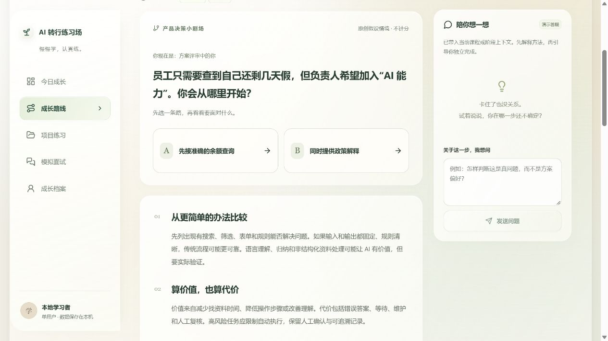
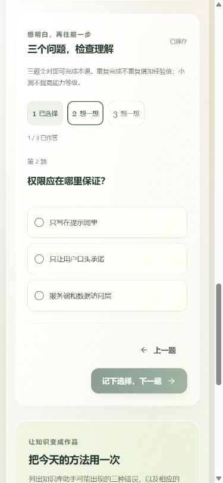

  

  <strong>陪你把学过的 AI 知识，变成做得出来、也讲得清楚的产品能力。</strong> 
  面向零基础转 AI 产品经理的中文训练应用，电脑端优先，也可以在手机上继续。

  <a href="#overview">项目概览</a> ·
  <a href="#journey">体验路径</a> ·
  <a href="#preview">界面预览</a> ·
  <a href="#capabilities">功能范围</a> ·
  <a href="#quickstart">本地运行</a> ·
  <a href="#boundaries">数据与边界</a>

---

## 项目概览

很多转行学习者能说出一些 AI 概念，却不容易回答：**这个场景为什么需要 AI？方案如何落地？作品怎样证明自己的判断？**

「AI 转行练习场」围绕一条可以回看的成长路径设计：先读懂目标岗位，再回答六道情境题；看过逐题反馈后，进入短课与四阶段项目；把改稿依据带进下一版作品，最后用模拟面试练习讲述。学习记录、回答和版本都保存在本机。

> **项目形态：可运行的本地单用户应用。** 使用 SQLite 持久化。未配置 AI 密钥也能体验完整的学习与文字训练流程；此时分析和点评明确标为演示结果，不生成虚构的能力分数。

## 推荐体验路径

| 步骤 | 你会做什么 | 为什么这样安排 |
| :--- | :--- | :--- |
| **01 · 明确目标** | 写下背景、目标岗位与招聘要求 | 让训练围绕实际想投的岗位展开，保留招聘原句作为依据 |
| **02 · 先看诊断** | 回答六道简短情境题，逐题查看反馈 | 先指出已说清与待补充之处，再由用户确认成长路线 |
| **03 · 学一点，判断一次** | 在短课中比较两条产品决策路径，完成逐题小测 | 把概念放进取舍情境；小测只检查理解，不冒充岗位能力评价 |
| **04 · 做一份作品** | 完成“企业内部知识库问答助手”四阶段交付 | 草稿可恢复，正式提交留独立版本，反馈能带回原稿修改 |
| **05 · 讲清楚方案** | 进行按轮文字或语音模拟面试 | 问答和追问可暂停、恢复；复盘引用实际回答，不补造经历 |
| **06 · 回看证据** | 在成长档案查看历史、版本、复测和成果导出 | 没有有效证据的维度显示“待评估”，保留自己的变化轨迹 |

## 界面预览

**产品决策小剧场**：短课先给一个有取舍的场景。选一条路径，再看可能后果与下一步需要核实的事实。图片中的情境是原创模拟内容。

  

**逐题小测**：可以回看与修改，换题前保存草稿。三题完成后查看解释和当前计划里的下一站。

  

## 功能范围

| 模块 | 已实现的体验 | 设计上的约束 |
| :--- | :--- | :--- |
| **目标与初步诊断** | 背景、岗位文本、原文映射、六题草稿与逐题反馈 | 推测项交给用户确认；少量回答只形成初步反馈 |
| **成长路线与短课** | 12 节中文短课、每节三题、课程上下文答疑、可调整的任务路线 | 路线有前置关系；新建议不静默覆盖已有安排 |
| **项目训练** | 四阶段模板、Markdown 自动保存、不可覆盖的正式版本、绑定版本的点评 | 改稿入口保留旧版与引用；成果导出标明“训练项目”和假设 |
| **模拟面试** | 文字与按轮语音、暂停恢复、追问、问答复盘 | 未答题不算错误；转写文字须先确认，原始录音不持久化 |
| **资料与成长档案** | 历史查询、资料导入与核对、阶段复测、JSON / Markdown 导出 | 待核对资料不能进入训练；演示评价不写入真实能力证据 |

### 产品上的三个选择

1. **先反馈，再排路线。** 六题结束后展示回答原文、可继续展开的思路和优先练习点；学习者确认后才进入路线。
2. **反馈必须找得到原文。** 正式项目版本与面试回答保留引用，修改稿时能回到具体建议；没有证据就显示“待评估”。
3. **演示模式诚实可用。** 无密钥时仍可学习、提交、面试和导出，但规则提示不伪装成专业语义评价，语音服务未配置时提供文字流程。

## 本地运行

需要 Node.js 22.12+、pnpm 和可写入的本地目录。

~~~powershell
git clone https://github.com/Ttttracey/AI_career_lab.git
cd AI_career_lab
Copy-Item .env.example .env
pnpm install --frozen-lockfile
pnpm setup
pnpm dev
~~~

打开 **http://127.0.0.1:3000**。Windows 也可以双击项目根目录的 **启动练习场.cmd**，脚本会检查依赖并初始化数据库。已有学习数据时，重复运行种子脚本不会覆盖记录。

~~~powershell
pnpm typecheck
pnpm test
pnpm build
~~~

项目使用 Next.js App Router、TypeScript、Tailwind CSS、Prisma 与 SQLite。详细配置、AI 接口、资料导入、测试方法与存储结构见 [实现说明](docs/IMPLEMENTATION.md)；已执行的检查见 [验收记录](VALIDATION.md)。

## 数据与 AI 边界

- **数据在本机**：默认位于 prisma/dev.db；导入的原始资料在 .local/uploads/。这两处、.env、录音及测试产物都不会上传到仓库。需要备份时请一并保留数据库和上传目录。
- **AI 可选**：服务端填写 .env 中的 OPENAI_API_KEY 才启用真实文本服务；转写与语音合成还需分别配置模型。密钥不进入浏览器。没有配置时使用清楚标识的 DemoAI。
- **评价有范围**：演示反馈不计入真实能力档案；有证据的评价只覆盖当前任务维度。课程完成、经验值与能力等级分开记录。
- **运行范围**：目前是本地单用户应用，没有注册、认证或公开部署。GitHub 仓库展示的是源码，不能直接当作在线体验地址。

---

相关项目：[PM Skills](https://github.com/Ttttracey/PM_skills) · [智能问数平台](https://github.com/Ttttracey/intelligent-data-query-platform)